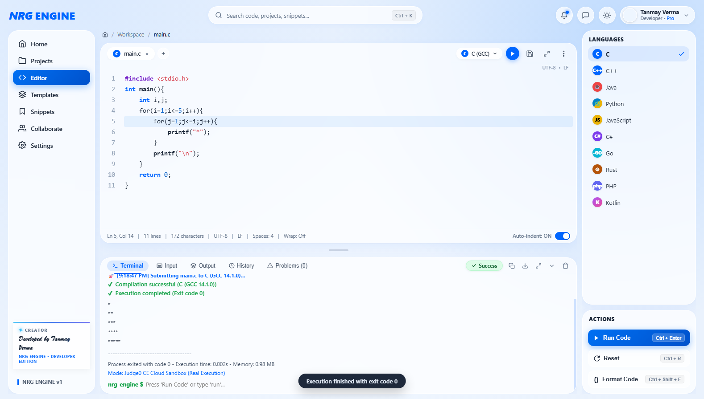
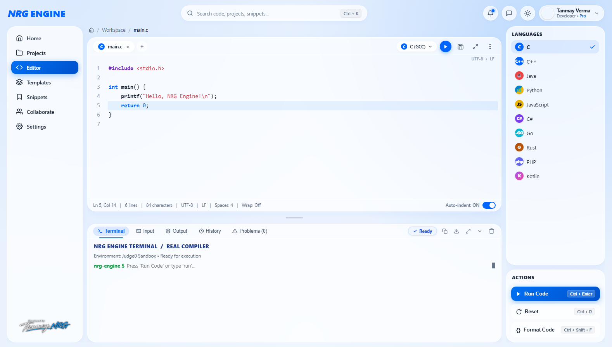
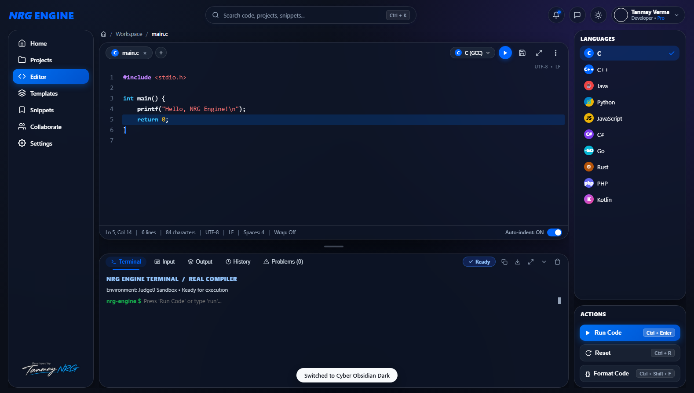
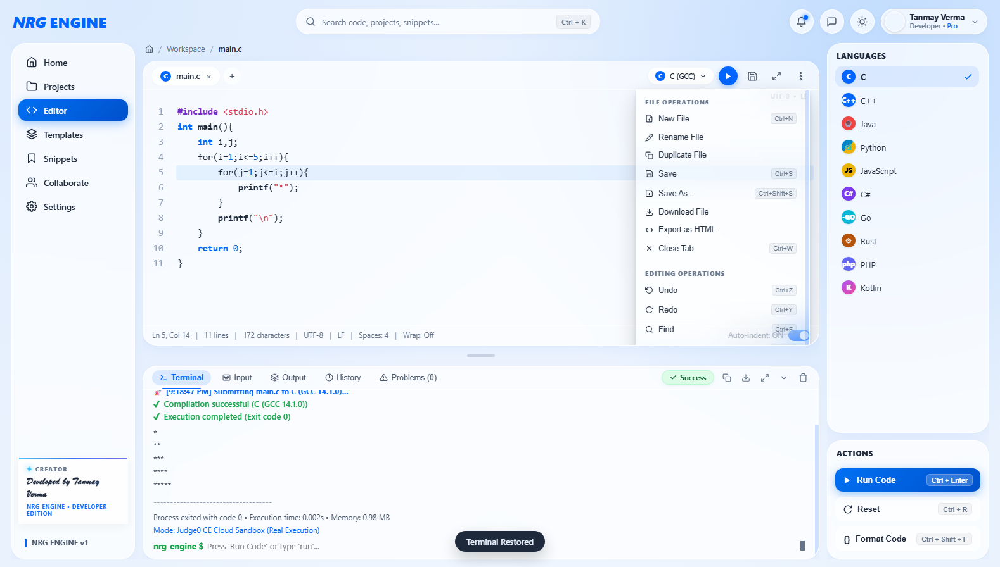
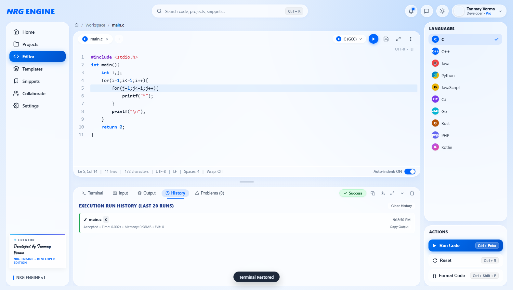

# NRG ENGINE — Cloud Coding Platform

[](https://vercel.com/new/clone?repository-url=https%3A%2F%2Fgithub.com%2FTanmay000156%2FNRG-Engine)



> **A modern, high-performance web-based IDE and cloud coding platform with genuine multi-language compilation, interactive terminal rendering, resizable workspace layout, and real-time execution.**

Developed with precision by **Tanmay Verma** (`NRG ENGINE • DEVELOPER EDITION`).

---

## ⚡ 1-Click Deploy to Vercel

NRG Engine is fully configured for zero-configuration, instant deployment on **Vercel** with full serverless compiler support.

[](https://vercel.com/new/clone?repository-url=https%3A%2F%2Fgithub.com%2FTanmay000156%2FNRG-Engine)

### Deploying via Vercel Dashboard

1. Click the **Deploy with Vercel** button above or go to [Vercel Dashboard](https://vercel.com/new).
2. Import repository: `https://github.com/Tanmay000156/NRG-Engine`.
3. (Optional) In **Environment Variables**, you can configure custom Judge0 endpoints:
   - `JUDGE0_API_URL` (Defaults to `https://ce.judge0.com` — no key required)
   - `JUDGE0_API_KEY` (Optional RapidAPI Key for higher rate limits)
4. Click **Deploy**. Your IDE and serverless compiler API will be live in under 30 seconds!

### Deploying via Vercel CLI

```bash
# Install Vercel CLI globally (if not already installed)
npm install -g vercel

# Deploy directly from repository root
vercel
```

### Vercel Serverless Architecture

- **Global Edge CDN:** The frontend application (`index.html`, styles, fonts, and assets) is served directly from Vercel's global edge network for sub-millisecond initial loading times.
- **Serverless API Routes (`/api/*`):**
  - `POST /api/execute` — Serverless execution engine with request streaming, Base64 payload encoding, and Judge0 integration.
  - `GET /api/health` — Microservice health checks and status probes.
  - `GET /api/languages` — Dynamic metadata for the 10 supported programming languages.
- **Dual Runtime Parity:** Zero lock-in. The project seamlessly runs as a standard Node.js server locally (`npm start`) and as serverless micro-lambdas on Vercel without altering a single line of frontend code.

---

## 🌟 Key Highlights & Capabilities

### 1. Real Multi-Language Compiler Backend
- **Judge0 CE Integration:** Genuine sandboxed compilation and execution across **10 programming languages**:
  - **C** (GCC 14.1.0)
  - **C++** (GCC 14.1.0)
  - **Java** (OpenJDK 17.0.6)
  - **Python** (3.11.2)
  - **JavaScript** (Node.js 20.11.1)
  - **C#** (Mono / .NET 7.0.1)
  - **Go** (1.22.0)
  - **Rust** (1.75.0)
  - **PHP** (8.3.2)
  - **Kotlin** (1.9.22)
- **Zero Simulation:** Real stdout, stderr, process exit codes, memory consumption, and wall-clock execution timing.

### 2. Terminal Output Rendering Engine
- **Exact stdout Preservation:** Verbatim preservation of `\n` newlines, `\t` tab stops, multiple spaces, blank lines, and Unicode characters (`★ ⚡ ☕ 🐍 💻`).
- **Multiline Nested Loops Fix:** Nested star triangles, inverted triangles, and space-padded pyramids render line-by-line without collapsing into a single line.
- **ANSI Color Terminal Parser:** Built-in decoder supporting 16-color and 256-color ANSI terminal escape sequences.
- **Terminal Controls:** Single-click **Copy Output to Clipboard** and **Download Output (.txt)**.

### 3. Resizable Workspace & Draggable Panels
- **Draggable Divider:** `#workspaceResizer` with `.resizer-handle-pill` for smooth mouse and touch vertical resizing between editor and terminal.
- **Layout State Persistence:** Panel proportions automatically persist in `localStorage` (`nrg_workspace_state`) across sessions.
- **Panel Maximizing & Collapsing:**
  - **Maximize Editor:** Hides the terminal and expands editor to 100% height.
  - **Maximize Terminal:** Hides the editor and expands terminal to 100% height.
  - **Collapse Terminal:** Folds the terminal into a compact 38px titlebar (`Ctrl+\``).
  - **Toggle Right Panel:** Collapses the language sidebar for ultra-wide focused coding.

### 4. Functional Three-Dot Workspace Menu
Accessible via the `⋮` button in the editor toolbar with 19 IDE operations:
- **File Operations:** New File (`Ctrl+N`), Rename File, Duplicate File, Save (`Ctrl+S`), Save As (`Ctrl+Shift+S`), Download File, **Export as HTML** (creates a standalone syntax-highlighted HTML document with line numbers), Close Tab (`Ctrl+W`).
- **Editing Operations:** Undo (`Ctrl+Z`), Redo (`Ctrl+Y`), Find (`Ctrl+F`), Find & Replace (`Ctrl+H`), Select All (`Ctrl+A`), Copy All Code, Format Document (`Ctrl+Shift+F`).
- **View & Settings:** Toggle Word Wrap, Increase/Decrease/Reset Font Size (`Ctrl+=` / `Ctrl+-`), Toggle Line Numbers.
- **Workspace & Panels:** Maximize Editor, Toggle Terminal (`Ctrl+\``), Toggle Right Panel, Reset Workspace Layout, Run History.

### 5. Multi-Tab File System
- Open multiple concurrent files with file tabs showing language icons, file names, dirty unsaved changes indicator (`•`), and close buttons (`×`).
- Language switching automatically syncs active file extensions, syntax highlighters, and compiler labels.

### 6. Advanced Code Editing Features
- **Smart Bracket Closing:** Automatically inserts matching pairs for `()`, `[]`, `{}`, `""`, `''`, and ```` ````; wraps highlighted selections.
- **Step-Over Caret:** Typing a closing bracket when directly before it steps the cursor forward without duplication.
- **Backspace Pair Deletion:** Backspacing between empty bracket pairs deletes both characters simultaneously.
- **Auto-Indent on Enter:** Preserves line indentation; adds 4 spaces after `{`, `(`, `[`, `:`; expands `{}` across 3 lines with cursor centered.
- **Floating Find & Replace Bar:** Real-time regex match count (`X of Y`), Previous/Next navigation, Match Case toggle, Replace, and Replace All.

### 7. Execution Run History
- Automatically records the last 20 execution runs in `localStorage` (`nrg_run_history`).
- Dedicated terminal **History** tab displays execution status badge (Success / Error / Timeout), timestamp, execution time, memory, and a "Copy Output" button.

---

## 📸 Screenshots

| Feature | Screenshot |
| :--- | :--- |
| **TANMAY NRG Signature (Light Mode)** |  |
| **TANMAY NRG Signature (Dark Mode)** |  |
| **Multiline Star Triangle Output** |  |
| **Three-Dot IDE Workspace Menu** |  |
| **Execution Run History Console** |  |

---

## ⌨️ Keyboard Shortcuts

| Shortcut | Action |
| :--- | :--- |
| `Ctrl + Enter` | **Run Code** (Compile & Execute) |
| `Ctrl + S` | **Save File** (Clears dirty indicator) |
| `Ctrl + Shift + S` | **Save As...** |
| `Ctrl + F` | **Find in Document** (Opens Floating Find bar) |
| `Ctrl + H` | **Find & Replace** (Opens Find & Replace bar) |
| `Ctrl + Shift + F` | **Format Document** (Auto-indentation) |
| `Ctrl + R` | **Reset Code** (Restores starter template) |
| `Ctrl + \`` | **Toggle Terminal** (Collapse / Expand) |
| `Ctrl + =` / `+` | **Increase Font Size** |
| `Ctrl + -` | **Decrease Font Size** |
| `Ctrl + K` | **Global Command Palette** |
| `Escape` | **Close Find Bar / Dropdown Menus / Modals** |

---

## 🚀 Getting Started

### Prerequisites
- [Node.js](https://nodejs.org/) (v18.0.0 or higher)

### Installation & Run

1. **Clone the repository:**
   ```bash
   git clone https://github.com/Tanmay000156/NRG-Engine.git
   cd NRG-Engine
   ```

2. **Start the Compiler Backend Server:**
   ```bash
   node server.js
   ```
   *Or double-click `start_nrg_engine.bat` on Windows.*

3. **Access the IDE:**
   - Open your browser at: `http://localhost:3000`
   - Or open `index.html` directly in any modern browser.

---

## 🏗 Architecture & Stack

- **Frontend:** Pure semantic HTML5, CSS3 Glassmorphism with variable themes (Light Frosted Glass, Cyber Obsidian Dark, Midnight Navy), and Vanilla JavaScript ES6+. Zero heavy framework dependencies.
- **Compiler Integration:** Node.js HTTP proxy service forwarding submissions to Judge0 CE REST endpoints, handling Base64 encoding/decoding, resource limit headers, and timeout handling.
- **Verification Engine:** Automated Chrome DevTools Protocol (CDP) test suite verifying DOM rendering, multiline outputs, and user interactions.

---

## 👤 Author & Architecture

**Developed by Tanmay Verma**  
*NRG ENGINE • DEVELOPER EDITION*  
GitHub: [@Tanmay000156](https://github.com/Tanmay000156)

---

## 📄 License

MIT License — Feel free to use, modify, and build upon this project.
